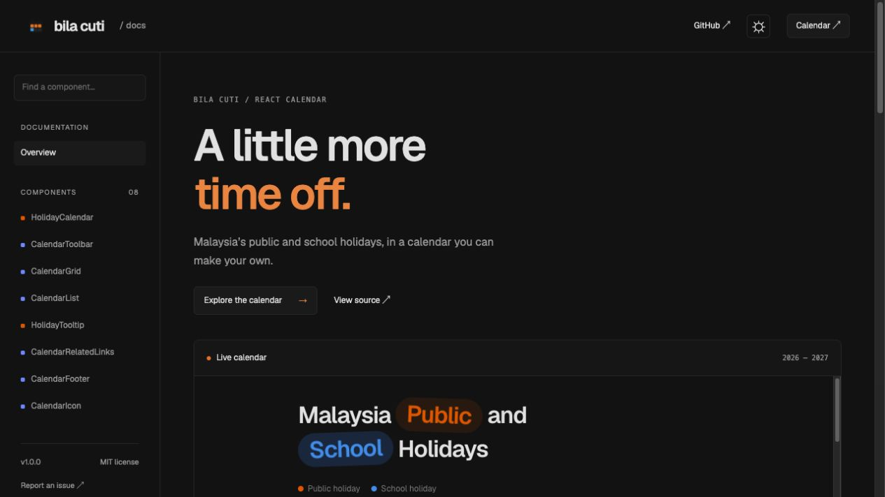
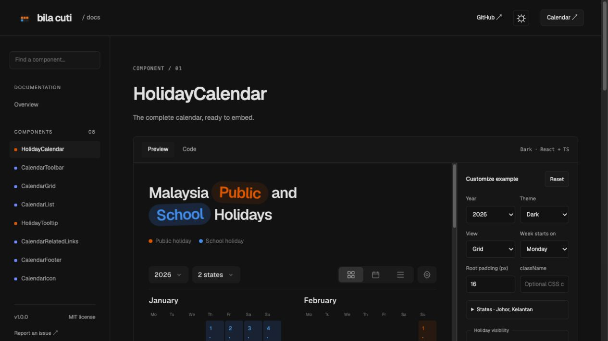
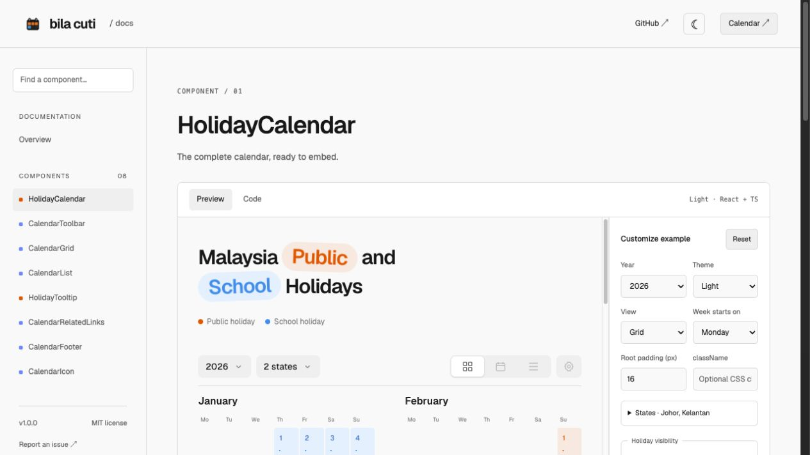
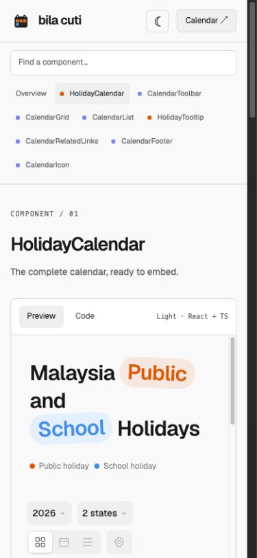

<p align="center"></p>

# Bila Cuti React Calendar

A little more time off.

[Documentation](https://qentrah.github.io/bilacuti-react-calendar/library/) · [Calendar demo](https://qentrah.github.io/bilacuti-react-calendar/) · [Download v1.0.0](https://qentrah.github.io/bilacuti-react-calendar/downloads/bilacuti-react-calendar-1.0.0.tgz) · [Contribute](CONTRIBUTING.md)



An independent, open-source React component library for Malaysia public and school holidays, maintained under **Qentrah**. Includes typed components, 2026–2027 holiday data, and a live playground with editable controls, props tables, and TypeScript that updates as you customize each example.

## Explore the components

The documentation follows the calendar’s charcoal surfaces, Geist typography, and orange and blue holiday colors. Use the theme switch to browse in light or dark mode.

Each component has its own linked page with a working preview, editable controls, a code view, and a props reference. Preview changes update the complete TypeScript example. Settings stay in place while you switch between components during the session. Search the sidebar to jump to a component.



<details>
<summary>Light theme and mobile previews</summary>





</details>

## Install

This package is distributed as an installable archive; it is **not published to the npm registry**. Download `bilacuti-react-calendar-1.0.0.tgz` from the playground and install it alongside React:

```sh
npm install react react-dom
npm install ./bilacuti-react-calendar-1.0.0.tgz
```

React 18.3 or React 19 is supported. The archive includes ESM, TypeScript declarations, scoped CSS, and the Geist font with its license. No Tailwind setup or external font service is needed.

```tsx
import { HolidayCalendar } from "@bilacuti/react-calendar";
import "@bilacuti/react-calendar/styles.css";

export function Holidays() {
  return (
    <HolidayCalendar
      defaultYear={2026}
      defaultStates={["johor", "kelantan"]}
      showJumpButton={false}
    />
  );
}
```

## Interactive examples and props

Every component on `/library/#ComponentName` has editable controls, a live preview, a props table, Reset, and Copy code in the Code view. Changes to the controls **and** changes made inside the live toolbar both update the generated TypeScript. Each example owns independent state.

| Component              | Playground controls                                                           | Public API                                                                          |
| ---------------------- | ----------------------------------------------------------------------------- | ----------------------------------------------------------------------------------- |
| `HolidayCalendar`      | Year, states, theme, view, week start, visibility, sections, padding, class   | Controlled or uncontrolled calendar; optional source dataset and callbacks          |
| `CalendarToolbar`      | Year, states, theme, view, week start, visibility, wrapper padding            | Controlled values and required change handlers                                      |
| `CalendarGrid`         | Year, states, theme, grid/month view, week start, visibility, wrapper padding | `year`, `events`, `view`, `weekStart`, `theme`, `idPrefix`, optional `onDateSelect` |
| `CalendarList`         | Year, states, event visibility, wrapper theme and padding                     | `events`                                                                            |
| `HolidayTooltip`       | Event name/date/kind/regions, theme, wrapper padding                          | `id`, `anchor`, `events`, `theme`, `onDismiss`                                      |
| `CalendarRelatedLinks` | Year, wrapper theme and padding                                               | `year`                                                                              |
| `CalendarFooter`       | Wrapper theme and padding                                                     | No component props                                                                  |
| `CalendarIcon`         | Icon type, wrapper color and padding                                          | Optional `type`; omitted renders the chevron                                        |

Wrapper controls are clearly labeled and appear as wrapper styles in the generated code. They are not invented component props. Composed components use a `<div className="bc-calendar" data-theme="dark">` wrapper. The full calendar creates that wrapper itself.

## Controlled state

```tsx
import { useState } from "react";
import { HolidayCalendar, type CalendarTheme } from "@bilacuti/react-calendar";
import "@bilacuti/react-calendar/styles.css";

export function ControlledCalendar() {
  const [year, setYear] = useState(2026);
  const [states, setStates] = useState(["johor", "kelantan"]);
  const [theme, setTheme] = useState<CalendarTheme>("dark");
  return (
    <HolidayCalendar
      year={year}
      onYearChange={setYear}
      states={states}
      onStatesChange={setStates}
      theme={theme}
      onThemeChange={setTheme}
      showFooter={false}
      showRelatedLinks={false}
      showJumpButton={false}
      onDateSelect={(date, events) => console.log(date, events)}
    />
  );
}
```

`year`, `states`, `theme`, `view`, `weekStart`, and `visibility` each have a matching `default…` prop for uncontrolled usage and an `on…Change` callback. `view` is `grid | month | list`; `weekStart` is `monday | sunday`. `visibility` is `{ public: boolean, school: boolean, annualLeave: boolean }`.

An empty state array includes all regions. `['nationwide']` restricts public holidays to nationwide events while retaining school holidays from both school groups. Slugs and names are exported as `states`.

The component does not mutate the document theme, browser URL, or global styles. The demo adapter handles URL state separately. The jump button is fixed to the viewport in the library and can be disabled for embedded layouts. The root has a 672px maximum width and vertical padding; customize through `style`.

## Custom data and utilities

Pass `data: HolidayDataset` to replace the bundled year-indexed dataset. Each year has `year`, `publicHolidays`, and `schoolHolidays`. Public events have an ISO `date`, `name`, and `regions`; school ranges have inclusive `startDate`, `endDate`, `name`, group `A | B`, and optional `regions`. Unsupported years fall back to the first available dataset year. An empty dataset throws a descriptive error.

Exports include all components in the table, their named props types where defined, `CalendarEvent`, `HolidayDataset`, other calendar types, `malaysiaHolidayData`, `states`, `schoolGroupA`, `schoolGroupB`, `monthNames`, `regionName`, `filterCalendarEvents`, `eventsOnDate`, `monthOffset`, `dateKey`, and `useControllable`.

Annual leave recommendations are a simple heuristic: Monday before a Tuesday holiday and Friday after a Thursday holiday, excluding existing public holidays and duplicate dates. They are not official leave guidance or a complete long-weekend planner.

## Develop and build

Use Node.js 24:

```sh
npm ci
npm run dev             # Calendar at /; playground at /library/
npm test                # Calendar and API-reference regression tests
npm run typecheck
npm run build:lib        # ESM, CSS, and declarations in lib/
npm run test:examples    # Compile generated snippets against package declarations
npm run prepare:download # Package the current library for the website download
npm run build            # Static demo and directly loadable /library/ in dist/
```

`npm run pack:lib` also builds and creates an installable archive. `src/lib` contains the reusable library; `src/playground` contains shared playground settings, code generation, controls, and API reference metadata; `src/LibraryPage.tsx` composes the documentation page.

## GitHub Pages

The workflow in `.github/workflows/pages.yml` checks pull requests and deploys successful `main` builds using GitHub Actions. It builds with `SITE_BASE_PATH=/bilacuti-react-calendar/` so links, fonts, scripts, and package downloads work under the repository path. `/library/` gets a real HTML entry point, so direct links and reloads work without an SPA fallback. For another host, omit `SITE_BASE_PATH` or set your own trailing-slash base path.

## License and attribution

The independently authored implementation and documentation are licensed under [MIT](LICENSE). The bundled Geist font remains under [SIL OFL 1.1](licenses/Geist-OFL.txt). See [THIRD_PARTY_NOTICES.md](THIRD_PARTY_NOTICES.md) for font, source inspiration, holiday data provenance, and dependency attribution.

Inspired by [bilacuti.my](https://www.bilacuti.my/), created by [Gaddafi Rusli](https://x.com/gaddafirusli). This is an independent implementation, not the original Bilacuti repository. Holiday data is a static 2026–2027 snapshot and does not update automatically.

The calendar logo in `public/brand/logo.png` was generated for this independent project and is included under the project’s MIT license. It is not the original Bilacuti brand mark. Screenshots in `docs/images/` show the running application.

See [CONTRIBUTING.md](CONTRIBUTING.md) to contribute.
